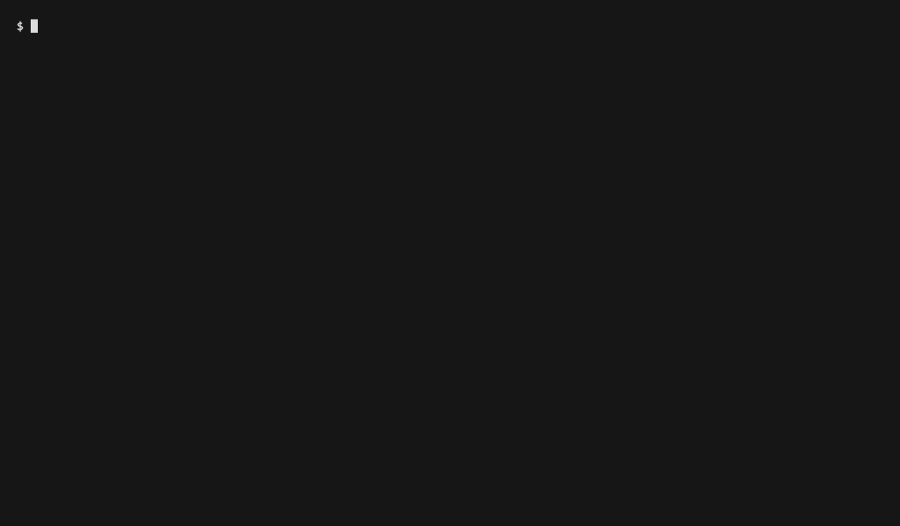
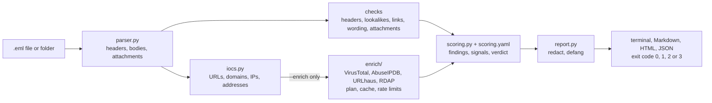

# PhishTriage

A Python command-line tool that takes a suspicious `.eml` email and produces an explainable phishing verdict and
triage report: Likely benign, Suspicious or Malicious, with every point of the score tied to a named rule.

> **Status: complete (5 of 5 weeks).** Evaluated blind on 24 Nov 2026, once, on 100 emails it had never seen,
> with the scoring frozen and the method written down beforehand. The results, good and bad, are below.

## Demo



The demo uses only the safe, hand-built test emails in `tests/fixtures/` and makes no lookups. It is recorded
from [`demo/demo.tape`](demo/demo.tape) with [VHS](https://github.com/charmbracelet/vhs) (`vhs demo/demo.tape`).

Sample reports made from the same test emails, in the formats an analyst would attach to a ticket:

| Verdict | Markdown | HTML | JSON |
| --- | --- | --- | --- |
| Malicious (100) | [report.md](docs/sample-reports/malicious/report.md) | [report.html](docs/sample-reports/malicious/report.html) | [report.json](docs/sample-reports/malicious/report.json) |
| Suspicious (35) | [report.md](docs/sample-reports/suspicious/report.md) | [report.html](docs/sample-reports/suspicious/report.html) | [report.json](docs/sample-reports/suspicious/report.json) |
| Likely benign (0) | [report.md](docs/sample-reports/benign/report.md) | [report.html](docs/sample-reports/benign/report.html) | [report.json](docs/sample-reports/benign/report.json) |

## Results (blind)

| Measure | Result | 95% range | Proposal target |
| --- | --- | --- | --- |
| Genuine emails flagged, with threat-intel lookups | **0 of 50** (0%) | 0% to 7.1% | under 10%: **met** |
| Genuine emails flagged, headers and content only | 0 of 50 (0%) | 0% to 7.1% | under 10%: met |
| Phishing caught, headers and content only | **23 of 50** (46%) | 31.8% to 60.7% | none set |
| Correct verdicts, 50 genuine + 50 phishing, headers and content only | **73 of 100** (73%) | 63.2% to 81.4% | at least 85%: **not met** |
| Precision: flagged emails that were phishing | 23 of 23 (100%) | 85.2% to 100% | none set |

"Flagged" means Suspicious or Malicious. The ranges are exact 95% (Clopper-Pearson) intervals: with 50 emails,
even 0 of 50 only shows that the true rate is probably below 7.1%.

| Emails (headers and content only) | Likely benign | Suspicious | Malicious |
| --- | --- | --- | --- |
| Genuine (50, my own inbox) | 50 | 0 | 0 |
| Phishing (50, phishing_pot) | 27 | 23 | 0 |

**In plain words:** PhishTriage raised no false alarm on 50 unseen genuine emails, with or without lookups, and
everything it flagged was phishing. Without lookups it caught a little under half of the phishing, so it misses
too much to meet the 85% target. How well it detects real phishing **with** lookups was **not measured** (see
"Limitations").

Also measured in the same blind runs:

- **Every email got a verdict and a report:** 100 of 100 analysed, 0 failed, every Markdown, HTML and JSON report
  written after the safety check, every `report.json` valid against its schema.
- **Every point has a named rule:** all 100 scores were rebuilt from their rule names alone, and all matched.
- **Lookups on the 50 genuine emails:** 306 planned, every one answered, 0 rate-limit errors (HTTP 429), 4.7 API
  calls per email, 23% answered from the cache. No threat-intel signal earned a point on any genuine email: the
  evidence thresholds held on mail they were not set on.
- **Time:** 28 seconds per email with lookups (VirusTotal's free plan allows 4 requests a minute); well under a
  second per email without them.

## Proposal targets

| # | Target | How it was measured | Status |
| --- | --- | --- | --- |
| O1 | Parse any `.eml`, nested and malformed included, without crashing | 245 real emails: 145 genuine (130 from my inbox plus 20 from weeks 1 and 2, 5 of which were already among the 130) and 100 phishing_pot; 0 crashes, 0 failed. Malformed input: tests on hand-built broken files | Met |
| O2 | Every header check in the proposal implemented and tested | SPF, DKIM and alignment, DMARC, Reply-To, Return-Path, display name, lookalike domains and the sender IP are. Not built: Message-ID domain, Received-chain hops and timing, a dkimpy fallback | Partly met |
| O3 | IOCs match a hand-checked list on 20 emails | 20 emails; blind on 10: domains 94%, addresses 87%, IPs and attachments 100%, 0 false positives | Met (week 2) |
| O4 | No quota errors in a 100-email batch | Two batches of 50 genuine emails with lookups: 0 quota errors each. A single 100-email batch was not run | Partly met |
| O5 | Every point links to a named rule | All 100 blind scores rebuilt from rule names; every report lists each rule with its points | Met |
| O6 | At least 85% correct, under 10% false positives (50 + 50) | Blind, above | False positives met; correct verdicts not met |
| O7 | Markdown, HTML and JSON for every run | Every run; 100 of 100 unseen emails, schema-valid | Met |
| O8 | At least 70% coverage, CI on GitHub, README with sample reports | 99% coverage, 1,542 tests on Python 3.12, 3.13 and 3.15; this README, a demo and three sample reports; the CI workflow runs once the repository is on GitHub | Coverage and README met; CI pending |

## What it does

- **Parses** an `.eml` file into headers, bodies and attachments, and records problems as defects instead of crashing.
  An email forwarded as an attachment (`message/rfc822`) is analysed on its own, up to 3 levels deep.
- **Checks the headers:** SPF, DKIM and DMARC from the trusted `Authentication-Results` header, and whether
  Reply-To, Return-Path or the display name point to a different organisation than the sender. Organisations are
  compared by registered domain (Public Suffix List, offline), so `bounce.paypal.com` is PayPal but
  `paypal.com.evil.test` is not.
- **Spots imitation:** sender domains that look like a brand (`paypa1.com`), brand names inside someone else's
  domain, and a display name that claims a brand the email did not come from.
- **Extracts IOCs:** URLs (text, HTML attributes, CSS, alt text; Microsoft Safe Links and Proofpoint unwrapped;
  links carried inside other links followed), domains, public sender IPs from the Received headers, and email
  addresses, each with a record of where it was found.
- **Inspects attachments without opening them:** hashes, the real type from the file's bytes (libmagic), double
  extensions, risky types, and the file list of a ZIP, including whether it is password-protected.
- **Reads the wording:** pressure ("within 24 hours") and requests for a login, password or payment.
- **Looks up IOCs** (optional, `--enrich`) in VirusTotal, AbuseIPDB, URLhaus and RDAP (domain age), within each
  free plan's limits, with a cache on disk. Your own addresses are removed from every value before it is sent.
- **Scores the email** from a table of signals in `scoring.yaml` and gives a verdict with every reason listed,
  tagged with MITRE ATT&CK (T1566.001 attachment, T1566.002 link).
- **Writes the report** in the terminal, and on request as Markdown, HTML and JSON. All four say the same thing.



Only the enrichment step touches the network, and only with `--enrich`.

## Safety rules

- PhishTriage **never** opens attachments, renders HTML or visits links. It only reads bytes, parses text and
  computes hashes. HTML is parsed into a tree; no script runs and no image loads.
- Without `--enrich` it never touches the network (a test checks this). With `--enrich`, `--hosts-only` sends host
  names only, never full URLs, and `--dry-run` shows what would be sent without sending anything.
- Every URL, domain, IP and address in a report is defanged (`hxxps://evil[.]test`), so nothing can be clicked.
  Control and bidi characters from an email (terminal escapes, U+202E) are written out as visible text, never
  printed raw.
- Recipient addresses and the addresses in `PHISHTRIAGE_MY_ADDRESSES` are replaced with `REDACTED` in every
  report format.
- Before `--out` writes anything, the rendered Markdown, HTML and JSON are checked once more against what the
  templates are allowed to write; a script, a link, anything that loads, or a live address or domain means no
  report is written at all. The files are readable by you only (`rw-------`), like the emails they describe.
- Keep real phishing samples, and the reports made from them, in `samples/` **inside a VM or another isolated
  machine**. `samples/`, `reports/` and `.env` are git-ignored. `scripts/pack.py` zips the code and tests only,
  and writes no zip at all if a secret, an email, a sample folder, a database or a symlink is where it should not
  be.
- Never double-click a real `.eml` file: a mail app would open it and could load remote tracking images.

## Setup (macOS / Linux)

Attachment type detection needs the libmagic library. Without it PhishTriage still runs and says so in the report.

```bash
brew install libmagic
```

On Debian, Ubuntu or Kali use `sudo apt-get install libmagic1` instead. Then:

```bash
git clone https://github.com/anujakawminda12-sudo/phishtriage.git
cd phishtriage
python3 -m venv .venv
source .venv/bin/activate
pip install -e ".[dev]"
```

For the lookups, copy `.env.example` to `.env`, keep it private (`chmod 600 .env`) and fill in the free API keys.
A missing key only switches that one service off. `phishtriage config` shows which services are ready and never
prints a key.

## Usage

Analyse one email, or every `.eml` file in a folder (the folder's subfolders are not read):

```bash
phishtriage analyze tests/fixtures/phish_paypal_spoof.eml
phishtriage analyze tests/fixtures/
```

Also write `report.md`, `report.html` and `report.json`, and a counts-only summary for later comparison:

```bash
phishtriage analyze tests/fixtures/ --out reports/run1 --stats reports/run1.json
```

The report as JSON on standard output, for a script, a SIEM or a SOAR playbook (messages go to standard error):

```bash
phishtriage analyze tests/fixtures/ --json > report.json
```

Threat-intel lookups: see the plan first, then run it:

```bash
phishtriage analyze samples/gate/ --enrich --hosts-only --dry-run
phishtriage analyze samples/gate/ --enrich --hosts-only --stats run.json
phishtriage cache
```

Other options: `--all-urls` lists every URL instead of grouping them by domain, `--allowlist FILE` and
`--scoring FILE` replace the built-in allowlist and scoring table, `--max-lookups N` caps new lookups per
service.

Other commands:

```bash
phishtriage results genuine.json phish.json
phishtriage calibrate legit.json phish.json --scoring candidate.yaml
phishtriage split-sets SOURCE OUT --seed 20261123
phishtriage fetch-label INBOX --user me@gmail.com --search "newer_than:6m" --newest 120 --list
phishtriage check-iocs samples/blind/ --make-templates
phishtriage version
```

`results` reads `--stats` files (held-out runs included) and prints the rates with their 95% ranges, the
proposal's targets, and genuine and phishing side by side; for an `--enrich` run it also works out the "headers
and content only" view from the same run. `calibrate` scores two `--stats` runs again with a candidate scoring
file and shows what would change; it refuses held-out runs. Neither opens an email. `split-sets` picks a held-out
set and a gate set at random. `fetch-label` downloads a Gmail label or search as `.eml` files over IMAP,
read-only, with an app password it asks for and never stores; `--list` shows date, sender and subject only.
`check-iocs` is the week 2 gate. These commands exit 0 when they worked and 1 when they could not.

## Exit codes

`analyze` exits with the verdict, so a script can act on it. In a folder, the worst file decides.

| Code | Meaning |
| --- | --- |
| 0 | Likely benign: every file scored 0-24. That is "no strong signs", not "safe". |
| 1 | Suspicious: the worst file scored 25-69. |
| 2 | Malicious: the worst file scored 70-100. |
| 3 | No verdict: a file could not be analysed, a held-out set was refused, `scoring.yaml` or the command line was wrong, or a report could not be written safely. One such file makes the whole run 3. |
| 130 | Stopped with Ctrl+C. |

A mistake on the command line is 3, not Click's usual 2, so 2 can only ever mean malicious.

## How a verdict is made

Every check returns findings, never points. `scoring.yaml` groups the findings into signals; each signal counts
**once** per email however many findings it has, the points are added up and capped at 100, and 70 or more is
malicious, 25-69 suspicious. A known-malware attachment makes the email malicious at once. A file with forwarded
emails inside is judged by its worst email.

| Signal | Points |
| --- | --- |
| An attachment is known malware (VirusTotal, URLhaus) | malicious at once |
| A link, domain or IP is flagged by threat intelligence | 35 |
| An attachment hides its real type behind a double extension | 30 |
| The From domain failed DMARC | 25 |
| The sender's domain imitates a brand | 20 |
| An attachment is a risky type, or not what its name says | 20 |
| The sender's domain uses a brand's name but is not the brand's | 15 |
| A link's text shows one site, but the link goes to another | 15 |
| Replies would go to a different organisation | 15 |
| The display name claims a brand that did not send the email | 15 |
| A domain in the email was registered less than 30 days ago | 15 |
| SPF failed | 10 |
| DKIM failed, is missing, or was not signed by the sender's domain | 10 |
| The sending IP is reported for abuse (AbuseIPDB) | 10 |
| More than one From address | 10 |
| A URL shortener or open redirect hides where a link goes | 5 |
| Pressure wording, or a request for a login, password or payment | 5 |
| Bounces go to a different organisation (Return-Path) | 5 |
| Link to the sender's own site with other text, no authentication results, extra authentication results | 0 (shown, not scored) |

Threat-intel hits count only above a threshold: at least 3 VirusTotal engines (5 for an attachment), an AbuseIPDB
confidence of 50 for the sender's IP, and a URLhaus host only with a listed URL still online. On genuine mail
single hits are common (17 of 50 genuine emails had at least one VirusTotal engine flag something, not blind).
Hits below the threshold are shown with the reason they did not count.

The points are the proposal's, plus a few rows marked "new" in `scoring.yaml`. One number was calibrated before
the blind test: "Suspicious" starts at 25 instead of the proposal's 30 (see below). Then the file was frozen; its
SHA-256 is `77c8089435bc8c70f6ad79a74e98004b65a64cf2c9255bccfe9adc2ed190bcf3`, a test pins it, and every report
records the SHA-256 of the scoring file it used. A misspelt, missing or duplicated rule stops the run with a
message instead of quietly scoring 0.

## Threat-intel lookups

| Service | What it answers | Pace used | Daily budget |
| --- | --- | --- | --- |
| VirusTotal (API v3) | engines that flag a URL, domain, IP or file hash | 4 a minute | 480 (free plan 500, 20 left for you) |
| AbuseIPDB (API v2) | abuse reports for an IP address (only the sender's IP can earn points) | 60 a minute | 950 (free plan 1,000) |
| URLhaus (abuse.ch) | known malware-distribution URLs and hosts | 60 a minute | no published quota |
| RDAP | when a domain was registered | 30 a minute | no quota |

Lookups are planned first, de-duplicated across the whole batch and sent most important first, so a value seen
in 30 emails is asked about once. Answers are cached in `~/.cache/phishtriage/cache.sqlite3`, outside the project
so it can never be zipped or committed: found for 24 hours, not found for 6 hours (domain age: 30 days and 1 day).
Every real API call is logged, and `phishtriage cache` shows the calls of the last 24 hours. A 429, a timeout or a
refused key is retried or reported, never a crash. The free plans are for non-commercial use only.

## How it was evaluated

**Data.** Genuine: 130 emails from my own inbox (downloaded read-only over IMAP, 23 May to 22 Nov 2026).
Phishing: [phishing_pot](https://github.com/rf-peixoto/phishing_pot) at commit
`78be141545ed9e56eefb857808ac78e83eb81b81`, 12,864 real phishing emails collected by honeypot addresses.

**Held-out sets, picked before they could be seen.** `split-sets` picked 50 held-out and 50 gate emails from
each source at random, with the seed `20261123` written down beforehand, and fingerprinted each set (SHA-256 of
the sorted file hashes). Everything built, tuned or looked at used the gate sets and earlier emails only.

| Set | Held-out fingerprint | Gate fingerprint |
| --- | --- | --- |
| Genuine | `b4be1f878e5261a7cd551473fc4e0c3d6945dec9c10f228df1139c396087e34d` | `0394ac3ca13a80cef57dd635c0c050576cf4d328f1f62e81ec0b3d3648416f50` |
| Phishing | `eebb955e77b6d2bbab4e70ee100ecd56d4f8f62dfbc59cdda3bf155f85c0d517` | `ee6d1c6c7713b8bdb4ab2c4b50a1100160b90fd856b4fb11709e7075ca7778fe` |

**The held-out guard is in the code.** `analyze` refuses a folder named `heldout` with `heldout.sha256` beside it
before reading any email, and skips any copy elsewhere with the same bytes or Message-ID. Only `--heldout-ok`, used
once per set for the blind test, turns this off.

**Calibration, once, on the gate sets (not blind).** Without lookups, the proposal's threshold of 30 flagged 0 of
50 genuine and caught 22 of 50 phishing gate emails; six phishing emails sat at exactly 25 and no genuine email
scored over 20. Lowering "Suspicious" to 25 caught 28 of 50 and still flagged 0 genuine. That one change was
adopted by a rule set before trying it, then everything was frozen: the scoring file, and a manifest of every
source file whose fingerprint matched on both machines.

**The blind runs, once each.** A protocol fixing the commands, the measures and the rules was written before any
held-out email was read. Both held-out sets were checked against their fingerprints, then analysed exactly once:
the genuine set with `--enrich --hosts-only` on my Mac, the phishing set offline in Claude's cloud workspace, an
isolated Linux sandbox run by Anthropic (real phishing never goes on the development Mac, and no API key went
into that workspace). `phishtriage results` computed every number above from the two `--stats` files, which
hold only scores, verdicts and rule names. Nothing in the scoring was changed after the blind runs.

**Changed after the blind runs: one compatibility fix, not a scoring change.** GitHub Actions now runs
Ubuntu 26.04, whose libmagic 5.46 reports a ZIP read from memory as `application/octet-stream`, a
[known libmagic bug](https://mailman.astron.com/pipermail/file/2025-January/001446.html). `detect_type()`
now corrects exactly that answer when the content starts with the ZIP signature `PK\x03\x04`. On both
evaluation machines libmagic recognised ZIPs itself (the test for it passed there before the blind runs), so
the correction does not apply to anything measured above. The code exactly as evaluated is the first commit
of this repository: its `src/` and `pyproject.toml` give the frozen manifest fingerprint
`91cee05c42508653f26f29012de13b8ae93c288e2d277a2442c65e82adfec230` (the SHA-256 of the `sha256sum` lines of
those 46 files, sorted by path).

To repeat the phishing side (inside a VM, never on your own computer):

```bash
git clone https://github.com/rf-peixoto/phishing_pot
git -C phishing_pot checkout 78be141545ed9e56eefb857808ac78e83eb81b81
phishtriage split-sets phishing_pot/email samples/phish --seed 20261123
cd samples/phish && sha256sum -c heldout.sha256 && cd ../..
phishtriage analyze samples/phish/heldout --heldout-ok --json --stats phish.json > /dev/null
```

## Not blind: numbers measured on emails seen while building

| What | Result |
| --- | --- |
| Week 2, IOC extraction, 10 new real emails, answer sheets written before the tool ran (**blind**) | domains 49/52 (94%), IPs 11/11, addresses 20/23 (87%), attachments 2/2, 0 false positives |
| Week 2, the same 10 after the fixes they led to | 52/52, 11/11, 23/23, 2/2, 0 false positives |
| Week 3, lookups on 50 genuine gate emails | 0 HTTP 429s, 0 crashes; 17 had at least one VirusTotal engine flag something and 25 an AbuseIPDB report, which is why the evidence thresholds exist |
| Week 4, reports on 100 genuine files and 50 phishing gate emails | every one with a verdict and a valid report; genuine all likely benign (highest score 20) |
| Gate sets, without lookups, threshold 30 then 25 | genuine 0 of 50 flagged; phishing 22, then 28, of 50 caught |
| The blind phishing run read again with the old threshold of 30 (after the results) | 21 of 50 caught instead of 23 |

## Lessons learned

- **Evidence thresholds were essential.** Single VirusTotal engines and AbuseIPDB reports are common on genuine
  mail. With the thresholds, no lookup earned a point on any of the 50 unseen genuine emails.
- **Header signs alone catch about half of this phishing.** DKIM problems showed up in 42 of the 50 held-out
  phishing emails and none of the 50 genuine ones, but they are worth 10 points, so on their own they never reach
  "Suspicious". 20 of the 27 missed phishing emails showed a DKIM problem with at most one other small sign; 3
  showed no sign at all. Phishing sent from a domain the sender controls can pass SPF, DKIM and DMARC.
- **Gains found on one set shrink on the next.** Lowering the threshold gained 6 phishing emails on the gate set
  it was chosen on, and 2 on the held-out set.
- **50 emails give wide ranges.** 0 of 50 still allows a true rate up to 7.1%; 23 of 50 could be anything from
  about 32% to 61%. A bigger held-out set would narrow both.
- **Writing the method down first kept the result honest.** The protocol, the frozen hashes and the held-out guard
  in the code made it impossible to tune on the test emails without it showing.

## Limitations

- **Detection with lookups on real phishing was not measured.** Real phishing was analysed only offline, so the
  strongest signal (a flagged link, 35 points) never had a chance to count on it.
- **The phishing labels are the dataset's.** phishing_pot is mail received by honeypot addresses; its own dataset
  card says it also holds spam, scams and malware, and I did not label the emails by hand. Some phishing_pot emails
  may have been seen while building; if about 10 were, the chance that any is among the 50 held-out is about 4%.
- **The genuine emails come from one inbox** (everyday personal email). Another person's or a company's mail
  may score differently.
- **Two machines.** The genuine run was on my Mac (Python 3.15.0), the phishing run in Claude's workspace
  (Python 3.15.0b4), both with the same code fingerprint and the same library versions.
- **Header checks not built:** a Message-ID domain check, Received-chain hops and timing, and a DKIM check with
  dkimpy when no trusted `Authentication-Results` header exists (that needs a live DNS lookup of today's key,
  which may have changed since the email arrived). Reports have no "recommended actions" section.
- Only addresses are redacted. A display name stays (`Your Name <REDACTED>`), and so does a user name inside a
  URL (`auth?user=yourname`).
- The held-out protection recognises a copy by its bytes or its Message-ID, so an edited copy without its
  Message-ID is missed. It finds the `heldout.sha256` lists only in the project's `samples/` folder or a `samples`
  folder above the analysed path. `check-iocs` is not guarded; it only reads emails you wrote an answer sheet for.
- `--enrich --dry-run` analyses nothing and exits 0. `--stats` does not create a missing folder.
- The JSON report lists files in the order they were read; the other formats add a worst-first summary.
- Domains written as plain text without a link ("dola.com") are not extracted. Destinations hidden in base64
  inside tracking links are not decoded. Links inside Outlook-only HTML comments (`<!--[if mso]>`) are not read.
- Genuine bulk mail often uses click tracking and mailing services, which produce real but harmless findings
  (open redirects, a different Return-Path). They are weighted low, but they are not zero.

## Tests

```bash
pytest -q
pytest --cov=phishtriage --cov-report=term-missing
ruff check .
ruff format --check .
```

1,542 tests, 99% coverage, on Python 3.12, 3.13 and 3.15 (GitHub Actions runs all three). No test can use the
network or read your real `.env` or `samples/`. New tests are mutation-tested while they are written: the code
they protect is broken on purpose, one change at a time, to prove that a test fails.

## Project layout

```text
src/phishtriage/
  cli.py            command-line interface: options, phases, exit codes
  parser.py         .eml -> ParsedEmail (headers, bodies, attachments, forwarded emails)
  analysis.py       one email's checks, without printing anything
  headers.py        SPF/DKIM/DMARC results and sender checks
  domains.py        registered domains and real-domain checks (tldextract, offline)
  lookalike.py      sender domains that imitate a brand
  content.py        pressure and credential-request wording
  iocs.py           URL, domain, IP and address extraction; refang, defang, unwrap
  links.py          link text vs real destination
  attachments.py    real file type, risky names, ZIP listing (nothing is extracted)
  allowlist.py      domains whose lookups are skipped (never marked safe)
  privacy.py        your own addresses kept out of every lookup
  config.py         API keys and settings from .env (never shown)
  enrich/           planning, rate limits, cache, VirusTotal, AbuseIPDB, URLhaus, RDAP
  scoring.py        findings -> signals -> score -> verdict
  scoring.yaml      the scoring table (frozen)
  calibrate.py      per-file rows for --stats, and scoring them again with a candidate
  results.py        rates, 95% ranges and the proposal's targets from --stats runs
  report.py         the report model: scored, redacted, defanged, as plain data
  render/           terminal, Markdown, HTML and JSON renderers, and the safety check
  display.py        outside text made safe to print in a terminal
  datasets.py       held-out and gate sets, fingerprints, the held-out lists
  imap_export.py    read-only Gmail download over IMAP
  evaluate.py       answer sheets and scoring for check-iocs
scripts/pack.py     zip the code and tests only, to move the project to a VM
tests/
  fixtures/         safe, hand-built test emails (no real malware, no personal data)
```

## Roadmap

| Week | Phase | Gate | Status |
| --- | --- | --- | --- |
| 1 | Setup, parser, header checks | Parses 10 real samples cleanly | Done |
| 2 | IOC extraction | IOCs match a hand-checked list | Done: 94% / 87% blind, 0 false positives |
| 3 | Enrichment: VirusTotal, AbuseIPDB, URLhaus, RDAP | 100 emails, no quota errors | Genuine half done (lookups on real phishing not run) |
| 4 | Scoring, reports, exit codes | Report works on every sample | Done: 100 genuine and 50 phishing emails (and 100 unseen ones in week 5) |
| 5 | Evaluation, README, demo | Targets met, results published here | Evaluated blind; targets reported above, met or not |

## How this was built

I planned PhishTriage in a project proposal (targets O1 to O8 above) and built it in five weekly phases, making
the decisions along the way: what to build, the scoring rules, the evaluation protocol and what to publish.
Claude (Anthropic) worked with me as an AI pair programmer. It wrote and tested much of the code, which I checked
and ran on my Mac, and it ran the offline phishing evaluation in its own workspace, so that real phishing never
touched my Mac (see "How it was evaluated").

## Credits

- Phishing emails: [phishing_pot](https://github.com/rf-peixoto/phishing_pot) by rf-peixoto, CC BY-NC 4.0,
  commit `78be141545ed9e56eefb857808ac78e83eb81b81`. Used for non-commercial evaluation only; no sample is
  included in this repository.
- Threat intelligence: VirusTotal, AbuseIPDB and URLhaus (abuse.ch) free APIs, and RDAP.

## License

MIT
